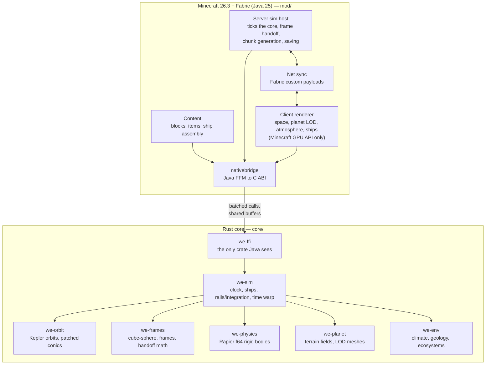
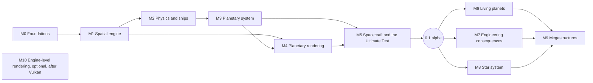

# WORLD ENGINE — Master Plan

> A Minecraft (Java Edition, Fabric) mod that turns the game into a physically simulated universe.
> Concept: [VISION.md](VISION.md). First executable step: [M0 implementation plan](superpowers/plans/2026-11-20-m0-foundations.md).

## 1. The goal in one paragraph

Minecraft stays the interface, the building system and the gameplay framework. A Rust **simulation core** owns the truth about the universe: where every celestial body and every ship is, how they move, and what the planets are made of. Players build machines out of ordinary blocks. Those machines get real mass, thrust and momentum, and they fly on real orbits around planets that you can walk all the way around.

### The North Star (the vision's "ultimate test")

> A player builds a spacecraft, launches from a procedurally generated planet, enters orbit, travels to its moon, lands there and returns, **without ever leaving the same continuous simulation**: no loading screens and no portal tricks.

Everything up to milestone M5 exists to pass this test. Nothing from M6 onward starts before it passes.

### Principles

1. **Capability before content.** Make Minecraft able to do something it cannot do today before adding many blocks and items. (This comes straight from the vision.)
2. **Every milestone ends in something you can play or watch.** No milestone is "infrastructure only" except M0.
3. **Risk first.** Prototype the hardest unknown of each milestone in its first two weeks.
4. **The simulation owns the truth.** Minecraft entities and chunks are a *view* of the simulation, not the source of it.
5. **Keep Minecraft-facing code thin.** Mojang ships about four drops a year and is replacing the renderer. All game-specific code sits behind small adapters, and mixins are few and documented.

---

## 2. Facts that shape this plan (checked 2026-11-20)

| Fact | Consequence for World Engine |
|---|---|
| The latest stable Java Edition is **26.3** (15 Sep 2026). 26.4 is in snapshots. | Target 26.3. Port only at milestone boundaries. |
| Java Edition has required **Java 25** since 26.1. | Java's **Foreign Function & Memory API** (final since Java 22) is always available. Use it instead of JNI. |
| Minecraft is **unobfuscated** since 26.1. Fabric dropped Yarn. Loom's non-remapping plugin is `net.fabricmc.fabric-loom`, with plain `implementation` dependencies. | Write code against Mojang's official names. No mappings setup is needed. |
| Mojang is **replacing OpenGL with Vulkan**. It is an experimental option in snapshots, not yet in a stable release, and mods that call OpenGL directly will break. | The vision's "Vulkan or OpenGL" choice is not ours to make. **Render only through Minecraft's own GPU abstraction.** Schedule heavy rendering work (M4, M10) to follow the switch. |
| 26.3 replaced GLFW with **SDL3** for windowing and input. | Input goes through Minecraft's key-mapping API, never through a windowing library directly. |
| Current versions: Fabric Loader 0.20.1, Fabric API 0.166.2+26.3, Loom 1.19.4. | These are pinned in the M0 plan. |

Sources: [Fabric 26.1 announcement](https://fabricmc.net/2026/03/14/261.html) · [Fabric mappings migration](https://docs.fabricmc.net/develop/porting/mappings/) · [Minecraft 26.1 development versions (Java 25)](https://minecraft.wiki/w/Java_Edition_26.1/Development_versions) · [26.3 release](https://www.gamingonlinux.com/2026/09/minecraft-java-edition-26-3-wilderness-bound-update-released/) · [Java Edition's move to Vulkan](https://www.windowscentral.com/gaming/minecraft/minecraft-java-edition-is-moving-to-a-new-graphics-api-for-its-vibrant-visuals-update) · [What Vulkan means for mods](https://www.neowin.net/news/minecraft-java-edition-is-upgrading-to-vulkan-but-its-not-great-news-for-mods/)

---

## 3. What this plan keeps from the vision and what it changes

The vision is the right ambition. These adjustments keep it buildable.

| The vision says | This plan does | Why |
|---|---|---|
| A custom Rust physics engine | Use **Rapier** (`rapier3d-f64`) for rigid bodies. Write custom code only for orbital mechanics and block-specific physics. | Writing a general physics engine from scratch takes years and doesn't make the mod better. Rapier is mature, in Rust and double-precision. |
| Rendering in Vulkan or OpenGL | Render through **Minecraft's own GPU abstraction** and stay compatible with Sodium. | Mojang is switching backends. Raw GL or Vulkan calls would break. |
| A custom client-server protocol | Use **Fabric custom payloads** over the vanilla connection. | No second port, NAT or server-host problems. Works on every server. |
| Procedural generation in Rust plus GPU compute | **Rust on the CPU first.** Add GPU compute only where profiling shows a need. | Determinism and testability. Dedicated servers usually have no GPU. |
| Fluid dynamics, heat transfer and energy conservation everywhere | **Targeted models**: atmospheric drag, re-entry heating and structural breakup first, then thermal and power networks. **Fluid dynamics is revisited after 0.1** (see the open decisions in §8). | Full fluid dynamics isn't tractable at game rates today. Players feel the targeted effects anyway. |
| Every planet runs geology, ecosystems and evolution live | Simulate **"pre-history" once at world creation**, then run a slow coarse live simulation, then **catch up** when chunks load. | This delivers "millions of years of evolution" for seconds of compute. |
| "A sufficiently massive object influences orbital trajectories" | **Patched conics** (one dominant body at a time) through M8. Full N-body arrives in M9, when planetary engines need it. | Stable, deterministic and cheap. It allows time warp, and client and server compute identical results. |
| "Life could evolve according to environmental conditions" | **Both, combined** (M6). **Populations** run the day-to-day ecosystem: species spread, compete and cycle as predators and prey. **Genetic evolution** changes the species themselves: traits are inherited, mutate and are selected by the environment, and new species split off. | Populations keep the live simulation cheap and readable. Evolution makes each planet's life unique and gives "millions of years of simulated evolution" real meaning. |
| "Forget dimensions. One continuous environment." | **One continuous simulation.** The voxels live in one Minecraft level, and the handoffs between regions of it are invisible. | Truly spherical voxel planets with radial gravity would break almost every vanilla mechanic (mobs, redstone, fluids, structures, player movement). |
| GPU-driven chunk rendering, virtualized geometry, global illumination | **Deferred to M10**, after the Vulkan switch. | Highest cost and lowest necessity for the North Star. |

---

## 4. Architecture

### 4.1 Layers



**Rules for the boundary between Java and Rust**
- The C ABI is **coarse and batched**: one call per tick, chunk or frame, never one call per block. Bulk data crosses in shared memory buffers.
- Every exported function catches panics and returns a status code. A Rust bug becomes a Java exception, not a crashed JVM.
- `WE_ABI_VERSION` is checked at load. The Java descriptors and the Rust signatures change in the same commit.
- The same library runs on the client and on the server. Bodies on rails are computed identically on both from shared orbital elements, which keeps multiplayer state small.
- Physics runs on its own worker thread at a fixed 60 Hz, with results double-buffered. Minecraft's 20 Hz main thread never waits on it.

### 4.2 Key decisions

| Area | Decision | Revisit when |
|---|---|---|
| Loader | **Fabric** (as in the vision). The Sodium and Iris ecosystems live there. | A NeoForge port is requested *after* 0.1 |
| Game version | **26.3**. Port only at milestone boundaries. | Vulkan reaches a stable release |
| Core language | **Rust** behind a narrow C ABI | — |
| Java↔Rust interop | **FFM** (`java.lang.foreign`), not JNI | — |
| Rigid bodies | **Rapier** (`rapier3d-f64`) | Profiling shows Rapier is the bottleneck |
| Celestial motion | Planets and moons **on Kepler rails** (patched conics). Ships are integrated numerically while thrusting, in atmosphere or near other ships, and on rails while coasting. | N-body becomes a gameplay need (M9 planetary engines) |
| Precision | **f64** everywhere in the simulation. Rendering is camera-relative f32. | — |
| Units and axes | 1 block = 1 m, SI units throughout, **right-handed, Y-up** (the same as Minecraft) | — |
| World storage | **One "universe" level**. Planets are cube-sphere faces laid out as flat regions. Ships live in a shipyard region. | — |
| Rendering | Minecraft's GPU abstraction only. Don't replace the chunk renderer before 1.0. | M10 |
| Networking | Fabric custom payloads. The server is authoritative and clients interpolate. | — |
| Persistence | Simulation state is serialized by the core (versioned schema) into the world folder and saved alongside chunks. | — |

### 4.3 The spatial model (the central design problem)

Minecraft assumes a flat world with gravity along −Y. The vision wants spherical planets and orbits. The plan reconciles the two with **three frames** and **invisible handoffs** between them.

| Frame | Where the voxels live | Gravity | Used when |
|---|---|---|---|
| **Surface frame** | The planet's face regions in the universe level | −Y, scaled by altitude: g·(R/(R+h))² | On or near a planet: altitude under ~1.5 km and ground speed under ~150 m/s |
| **Ship frame** | The ship's plot in the shipyard | v1: zero-g, or 1 g toward the ship's −Y while a powered artificial-gravity block is aboard. Later: the ship's real acceleration and spin. | Aboard a ship in the orbital regime |
| **Universe frame** | None (pure simulation, f64, inertial) | The dominant body's gravity (patched conics) | The truth for all bodies, and for ships in the orbital regime |

**Planets as cube-spheres.** Each planet is a cube whose six faces are N×N block grids, projected onto a sphere. The renderer and the simulation see a sphere. Gameplay sees six flat grids where vanilla rules (−Y gravity, water, redstone, mobs) still hold. Terrain is a function of the *sphere* point, so terrain on both sides of a face edge always matches. Use a low-distortion cube-sphere projection, and measure its area and shape distortion in `we-frames` tests.

**Laying a planet out in the level.** The faces are placed as a cross-shaped cube net. The four equatorial faces sit side by side, so walking east or west around the equator is ordinary walking. The polar faces attach above and below one equatorial face. Of the cube's 12 edges, 5 are naturally continuous in this layout. The other 7 are **seams**:
- Each seam has an **overlap band**, about 128 blocks wide, holding a synchronized, rotated copy of the neighbouring face. Edits in a band are mirrored to its twin.
- Entities crossing the middle of the band are teleported to the twin position, which keeps the same level, momentum and look direction (rotated as needed). There is no loading screen.
- Past the band, the M4 level-of-detail (LOD) terrain shows the true neighbour.
- Known limitation: redstone and contraptions that span a seam are not supported. Terrain is biased toward deep ocean at the 8 cube corners, where three faces meet, to hide the geometry there.

```
One Minecraft dimension, seen from above (not to scale; faces separated by unused gaps)

  home planet, faces 16,384 x 16,384           moon, faces 4,096 x 4,096
           +-------+                                   +---+
           |   N   |                                   | N |
  +-------+-------+-------+-------+           +---+---+---+---+
  |  E0   |  E1   |  E2   |  E3   |           |E0 |E1 |E2 |E3 |
  +-------+-------+-------+-------+           +---+---+---+---+
           |   S   |                                   | S |
           +-------+                                   +---+

  shipyard: one 512 x 512 plot per ship, far from all planets
  +---+---+---+---+---+---+
  |   |   |   |   |   |   | ...
  +---+---+---+---+---+---+
```

**Ships.** A ship's blocks always live in its shipyard plot, axis-aligned, so block interaction, redstone and block entities work normally. The ship is rendered and collided at its simulated transform, wherever that is. The surface frame uses this approach the same way Valkyrien Skies does. While the ship flies low over a planet, players aboard stay in the surface frame and are carried along with it.

**Handoff between surface and orbit.** When a ship climbs above ~1.5 km or exceeds ~150 m/s, players aboard are handed from the surface frame into the ship frame. Their entity moves to the same spot inside the shipyard plot, and the planet outside is drawn from the simulation (M4). The transfer back happens below ~1.2 km and ~120 m/s. The gap between the two thresholds prevents flickering between frames. Position and velocity are carried across through the cube-sphere projection, accounting for the planet's rotation. Tests enforce round-trip error under 1 cm and 1 mm/s. "Seamless" means no loading screen and no visual pop, *not* that the entity never moves inside the level.

### 4.4 Reference scale (initial values, tunable)

Values marked † are from the M0 tests. The others are derived from the same formulas.

| Quantity | Value | Notes |
|---|---|---|
| Home planet face | 16,384 × 16,384 blocks | Radius ≈ 10,430 m† |
| Home surface gravity | 9.81 m/s² | μ ≈ 1.067 × 10⁹ m³/s² |
| Home day length | 20 min | Matches vanilla. The equator moves at ≈ 55 m/s, which gives an eastward launch bonus. |
| Atmosphere | Top ≈ 2,500 m, exponential density | Scale height is tuned in M5 |
| Low orbit (13.4 km radius) | ≈ 282 m/s, period ≈ 5 min | Escape speed from the surface ≈ 452 m/s |
| Moon | Radius 2,600 m, 1.62 m/s², circular 60 km orbit | Period ≈ 47 min†. Sphere of influence ≈ 9.6 km. |
| Low orbit → moon transfer | Δv ≈ 79 m/s, ≈ 11 min coast | Time warp makes this short |
| Full North Star mission | ≈ 0.8–1.0 km/s Δv (estimate) | Small rockets can do it, which is good for play |

Planets are deliberately small, like Kerbal Space Program's. Orbits take minutes, not hours, and a planet can be circumnavigated on foot in about an hour.

### 4.5 Target repository layout

```
world-engine/
├── core/                       Rust workspace
│   ├── Cargo.toml
│   └── crates/
│       ├── we-orbit/           M0  Kepler orbits, celestial hierarchy
│       ├── we-ffi/             M0  C ABI (cdylib "worldengine_core")
│       ├── we-frames/          M1  cube-sphere projection, frames, handoff math
│       ├── we-planet/          M1  terrain fields; M4 LOD meshes; M6 pre-history
│       ├── we-physics/         M2  Rapier wrapper, ship bodies, mass properties
│       ├── we-sim/             M3  clock, ships, rails/integration, scenarios
│       ├── we-env/             M6  live environmental simulation
│       ├── we-life/            M6  species, genomes, populations, evolution
│       └── we-sandbox/         M1+ dev-only viewer and headless scenario runner
├── mod/                        Fabric mod (Gradle + Loom)
│   └── src/main/java/io/github/chabelabela/worldengine/
│       ├── nativebridge/       M0  FFM bindings, native loading
│       ├── universe/           M1  server host for the simulation, world preset, level layout
│       ├── planet/             M1  chunk generator, seams, overlap bands
│       ├── ship/               M2  assembly, shipyard, ship entities
│       ├── net/                M2  payloads
│       ├── content/            M2  blocks and items
│       └── client/render/      M2  ship rendering; M4 space, LOD, atmosphere
├── docs/                       vision, roadmap, design records, plans
└── .github/workflows/ci.yml    5-platform native builds + mod jar
```

---

## 5. Milestones



The sizes below are **rough planning ranges for one experienced developer working full time**. They are not commitments; re-estimate after M1. A second developer working on rendering can run M4 alongside M2 and M3, which saves about 3–4 months.

| Milestone | Size | Cumulative |
|---|---|---|
| M0 Foundations | 2–4 weeks | ~1 month |
| M1 Spatial engine | 2–3 months | ~3–4 months |
| M2 Physics and ships | 3–6 months | ~6–10 months |
| M3 Planetary system | 2–3 months | ~8–13 months |
| M4 Planetary rendering | 2–4 months | ~10–17 months |
| M5 Spacecraft and the Ultimate Test | 2–4 months | **~12–21 months to the North Star** |
| M6 Living planets (with evolution) | 4–8 months | Post-alpha |
| M7–M9 | 3–6 months each | Post-alpha |

### M0 — Foundations · *toolchain and bridge*
**Goal:** Rust core, Fabric mod and CI all work together on every platform before any gameplay work starts.
- Rust workspace with `we-orbit` (Kepler propagation, celestial hierarchy, demo home + moon system) and `we-ffi` (a C ABI that catches panics and returns status codes).
- Fabric mod for 26.3 that extracts the right native library from its jar and binds it with FFM. `/worldengine bodies` prints the live moon position.
- CI builds natives for 5 targets (linux x64/arm64, windows x64, macOS arm64/x64) and one jar that contains them all.

**Exit:** `/worldengine bodies` in a 26.3 world shows the moon 60 km from the home planet, moving over time, on Windows, macOS and Linux, from the CI-built jar.
**Detailed plan:** [2026-11-20-m0-foundations.md](superpowers/plans/2026-11-20-m0-foundations.md)

### M1 — Spatial engine · *"walk around a planet"*
**Goal:** Break Minecraft's flat-world assumption.
**Plans:**
- [M1 overview](superpowers/plans/2026-11-20-m1-overview.md): phases M1a–M1f and their order.
- [M1a foundations and frames](superpowers/plans/2026-11-20-m1a-foundations-and-frames.md): detailed, with verified code.
- [M1b handoff spike](superpowers/plans/2026-11-20-m1b-handoff-spike.md): an experiment plan that ends in an ADR.
- The M1c–M1f plans are written after M1a and the ADR.
- **Entry tasks from the M0 reviews:** done in M1a (see `docs/superpowers/plans/2026-11-20-m1a-foundations-and-frames.md`). Remaining items have new homes:
  - Thread-safe batched chunk generation is designed into M1c.
  - The clock source and debug-command permissions move to M3, with `we-sim`.
  - The period reduction of `t − epoch` was dropped after analysis. It can't beat the precision of an f64 `t`; M3 decides the clock representation.
- **Spike first (2 weeks, time-boxed):** a fake hand-moved "ship" carries a player between a planet face and a shipyard plot with no loading screen. Record the findings as a design record (`docs/adr/0001-frames-and-handoff.md`).
- `we-frames`: the cube-sphere projection, face↔block coordinates, the seam adjacency table with rotations, and the handoff transforms. Property tests cover round trips, adjacency consistency and distortion bounds.
- `we-planet` v0: deterministic terrain height and climate bands as functions on the unit sphere, keyed by seed.
- A **World Engine world preset**: the overworld becomes the universe level with the cross-net layout for the home planet and the moon. The Nether and End are left untouched for now.
- A chunk generator that makes one batched FFI call per chunk (heights and biome ids), with vanilla features and structures layered on top through biomes.
- Seams: overlap bands, edit mirroring, and entity teleport with rotated position, velocity and look direction.
- Per-planet time of day: the sun direction comes from planet rotation (mixins for sky angle and lighting, scoped to the universe level).

**Exit:** walk or fly around the home planet's equator and over a pole, and return to the start. Terrain never visibly breaks at seams. Sunrise and sunset follow planet rotation. Fabric GameTests for seam crossing and edit mirroring pass. The handoff design record is accepted.

### M2 — Physics and ships · *"blocks that fly"*
**Goal:** Any block structure can become a rigid body with correct mass properties and fly in the surface frame.
- `we-physics`: Rapier worlds on a worker thread at fixed 60 Hz. Colliders are built from blocks (merged boxes). Mass, center of mass and inertia come from a **block properties table** (datapack JSON with defaults per material, so modpacks can override it).
- Ship assembly: a *Ship Core* block flood-fills the connected structure, which moves into a shipyard plot. Disassembly is optional.
- Ship rendering at the simulated transform through Minecraft's GPU API, including block entities. Players can interact with ship blocks, stand and walk on moving ships, and ships collide with terrain (colliders generated from nearby chunks on demand).
- Minimal flight parts, there only to exercise the physics: thruster (fixed thrust, infinite fuel for now), control seat, reaction wheel.
- Net sync v1: ship transforms at 20 Hz with client interpolation. Multiplayer is tested from the start.

**Exit:** build a rocket in creative mode and fly it. An off-center thruster makes it tumble. Two players walk around on a moving ship and see the same thing. Twenty idle ships cost under 2 ms per tick.

### M3 — Planetary system · *"orbits are real"*
**Goal:** Bodies on rails, ships in real orbits, and seamless handoff between surface and orbit.
- `we-sim`: a server-authoritative universe clock with time warp (on rails only); the celestial system; ships switching between *integrated* and *on rails*; sphere-of-influence transitions.
- Ship-frame gameplay for the crew: zero-g movement and the artificial-gravity block.
- Frame handoff as designed in the M1 design record, with hysteresis and round-trip conservation tests.
- Map view and HUD: orbit lines, apoapsis and periapsis, sphere of influence, time to the next event.
- Persistence: the simulation state is versioned and saved with the world. Ships survive reloads in orbit.
- Energy conservation: coasting ships use a symplectic integrator, and a test bounds energy drift over 100 simulated orbits.

**Exit:** a crude rocket flown by hand reaches a stable orbit that survives save/reload and time warp. The apoapsis and periapsis readouts match `we-orbit` within 0.1%.

### M4 — Planetary rendering · *"see the curve"*
**Goal:** Seamless visuals from standing on the ground to seeing the whole planet from orbit.
- A space renderer: stars, sun, and planets and moons as LOD cube-sphere quadtrees. Meshes are built in Rust from `we-planet` and drawn camera-relative.
- Far terrain in the surface frame: LOD rings beyond vanilla render distance, bent by the *exact* projection so they line up with the orbital view. Edited chunks feed coarse summaries back into the LOD.
- Atmosphere: precomputed single scattering, aerial perspective and sunsets. It replaces the vanilla sky in the universe level.
- Clouds: a 2.5D layer driven by a weather field. Volumetric clouds come in M10.
- Compatibility: required with Sodium, best effort with Iris shaderpacks (with documentation of what World Engine overrides).

**Exit:** a recorded ascent from the ground to 10 km with no visible pop or seam. Each body is visible from the other. Rendering stays within budget: ≤ 3 ms GPU at 1080p on the reference mid-range GPU (define it in M0).

### M5 — Spacecraft engineering and the Ultimate Test
**Goal:** Pass the North Star test.
- Parts: fuel and oxidizer tanks, engines with thrust and specific impulse (Isp) that differ between sea level and vacuum, RCS, decouplers and staging, landing legs, parachutes, heat shield, wings and control surfaces.
- Atmosphere model: layered per planet, with pressure, temperature and density by altitude. Composition is added in M6.
- Aerodynamics: drag on every exposed face, computed from the ship's voxel surface, plus lift from wing and control-surface blocks. Planes and spaceplanes fly, not only rockets.
- Re-entry heating per face. Blocks past their heat tolerance are destroyed.
- Simple structural failure: each block connection has a strength. An overstressed connection splits the ship into separate bodies.
- Flight UX: navball, SAS attitude hold, throttle, staging UI, and maneuver nodes (stretch goal).
- Moon content: regolith and craters, low-gravity movement, vacuum, and a simple oxygen suit.
- **Autopilot scenario test:** the headless `we-sim` flies the whole mission with a scripted autopilot (gravity turn, circularize, transfer, capture, powered landing, ascent, return, re-entry). It becomes a CI gate.

**Exit:** the Ultimate Test passes three ways: (1) one player in a single continuous session; (2) two players aboard in multiplayer; (3) the automated scenario in CI. Then **release 0.1 as a public alpha**.

### M6 — Living planets · *environmental simulation and evolving life*
- **Pre-history at world creation** on a coarse grid of about 64–256 blocks per cell: simplified plate tectonics (plates, uplift, volcano placement), hydraulic and thermal erosion, river networks, and a climate model whose output becomes the biome map. Evolution (below) runs fast during this phase. Target: ≤ 2 min per planet on 8 cores, shown as a "planet forming" progress screen at world creation.
- **Slow live simulation:** weather cells (pressure, temperature and humidity driving rain, storms and snow), seasons from axial tilt, vegetation spread and retreat, and volcanic and glacial events as scheduled discrete events. Also tides driven by the moon.
- **Life (`we-life`): populations and evolution combined.**
  - **Genomes:** every species, plant or animal, has a genome, a small vector of heritable traits. Examples: temperature and humidity tolerance, size, diet, speed, reproduction rate, and appearance genes.
  - **Populations:** each cell holds populations per species, with trait distributions rather than individuals. They drive the visible ecosystem: spreading, competition, and predator/prey cycles.
  - **Evolution:** each generation step, traits are inherited with mutation, and the local environment selects (fitness = how well the traits match the cell's climate, food and predators).
  - **Speciation:** a population whose traits drift far enough from its parent species, or that is cut off by geography (an ocean, a mountain range), splits into a new species.
  - **Time scales:** evolution runs over millions of years in coarse steps during pre-history, and slowly during play. Players can watch a population adapt after they terraform or change the climate.
  - **In-game creatures:** each animal species maps to a mob variant whose scale, colours, model parts and behavior parameters come from its genome. It starts from vanilla mob bases, with procedural bodies later. Plant species map to tree and vegetation variants the same way.
  - **Bestiary:** a "tree of life" records discovered species and their ancestry.
- **Catch-up on chunk load:** deterministic replay of events, so unloaded regions evolve too.
- Player impact: deforestation, hunting pressure, atmosphere composition, terraforming hooks. All of them feed into selection.

**Exit:** two seeds produce planets that are distinct and geologically plausible. A region left unloaded for years of game time has visibly changed. Every player sees weather move consistently. Two planets with similar starting conditions end up with different species. After a large climate change, a population's traits measurably shift within a set number of in-game years. The bestiary shows a believable family tree.

### M7 — Engineering consequences · *stations and bases*
- A full structural stress graph, heat transfer with radiators, power networks, and life support (detecting sealed volumes, oxygen and CO₂).
- Docking and assembling stations in orbit.
- Planetary bases and colonies need air, water, energy and resources, supplied through the same life-support and power systems.
- Mining platforms on planets, and on asteroids once M8 adds them.
- Automated factories come from vanilla redstone and from Create, which the compatibility table expects to work.

**Exit:** a station assembled from several launches keeps its crew alive. Failures in power, heat or air are visible and diagnosable.

### M8 — Star system
- A star whose radiation and luminosity drive planet climates.
- Several procedurally generated planets: rocky, icy, and a gas giant you can't land on.
- An asteroid belt of instanced bodies on rails. Asteroids turn into voxel bodies when approached.
- Interplanetary transfers.

**Exit:** fly from home to another planet and land.

### M9 — Megastructures
- **Dyson swarm:** thousands of collectors modeled as orbital elements rather than rigid bodies. Their aggregated energy feeds player power networks, and the star visibly dims.
- **Rotating habitats:** spin gravity in the ship frame.
- **Orbital rings:** ring segments on rails.
- **Planetary engines:** they change a body's orbital elements over time. This requires rails that can change, so N-body work starts here.
- **Terraforming arrays:** they act on the M6 atmosphere model.
- Artificial planets come last.

**Exit:** a Dyson swarm measurably powers player infrastructure and changes what the system looks like.

### M10 — Engine-level rendering (optional)
GPU-driven chunk rendering, virtualized geometry, volumetric clouds, dynamic global illumination, and realistic water. Start this only after Mojang's Vulkan backend is stable, and only where profiling shows a need. Prefer contributing to or integrating with Sodium over competing with it.

---

## 6. Cross-cutting concerns

**Testing**
- Rust: unit tests, property tests (`proptest`) for all frame and projection math, golden-hash tests that hold generation deterministic per seed, and benchmarks (`criterion`) for hot paths.
- Scenario tests: headless `we-sim` scripts. The North Star autopilot test runs in CI from M5.
- Java: JUnit for the bridge, and Fabric GameTests for in-game behavior (seams, ship assembly, persistence).
- Each milestone ends with a manual playtest checklist and a recorded video.

**Performance budgets** (refine in M0)

| Budget | Target |
|---|---|
| Server: World Engine work per 50 ms tick | ≤ 10 ms with 20 active ships |
| Physics step | ≤ 8 ms on the worker thread |
| Client: planet and space rendering | ≤ 3 ms GPU at 1080p on the reference GPU |
| Network | ≤ 2 KB/s per nearby active ship per player |

**Multiplayer from day one.** Singleplayer runs on an integrated server, so the same server-authoritative code serves both. Bodies on rails are deterministic. Ships stream at 20 Hz near the player and less often far away. Client-side prediction for the pilot is a stretch goal in M5.

**Compatibility**

| Mod | Expected status |
|---|---|
| Sodium | Required to work from M2 |
| Iris | Best effort from M4 |
| Distant Horizons, Voxy | Overlap with the M4 far terrain. Detect them, then integrate or step aside. |
| Valkyrien Skies, Create: Aeronautics | Declared incompatible, because each also turns blocks into rigid bodies |
| Create | Expected to work for factories on planets. Inside ships is later. |

**Native distribution**
- 5 targets are built in CI.
- Linux builds should target an old glibc baseline (`cargo zigbuild` to glibc 2.17) before the first public release.
- Libraries are extracted to a cache folder named by content hash.
- Confirm Modrinth's and CurseForge's rules on bundled native binaries before publishing. An open-source core makes the review much easier.

---

## 7. Risk register

| # | Risk | Likelihood | Impact | Mitigation |
|---|---|---|---|---|
| 1 | Seamless handoff between frames is glitchy or infeasible | Med | **High** | M1 spike before anything else. Fallback: a brief atmospheric effect (clouds, plasma) masks a one-frame handoff. Still no loading screen. |
| 2 | The Vulkan switch breaks rendering code | High | High | Render only through Minecraft's GPU abstraction. Track snapshots during M4. Keep the renderer modular. |
| 3 | Version churn (about 4 drops a year) | High | Med | Pin a version per milestone. Keep adapters thin, mixins few, and list them in `docs/MIXINS.md`. |
| 4 | Physics cost of large block ships | Med | High | Merge boxes into compound colliders. Put inactive ships to sleep. Cap ship size in v1 (e.g. 32k blocks). Profile in M2. |
| 5 | Native binaries: platform quirks, glibc, antivirus false positives, store policies | Med | Med | CI on all 5 targets. glibc baseline. Open-source the core. Check store rules early. |
| 6 | Scope creep: the vision is enormous | **High** | **High** | The North Star gate: no M6+ work until M5 passes. Keep a "not now" list (below). |
| 7 | Mixin conflicts with popular mods | Med | Med | Few mixins. A CI smoke test that launches with Sodium. Keep the compatibility table current. |
| 8 | Multiplayer desync or bandwidth | Med | Med | Server-authoritative. Deterministic rails. Interest management. Measure bytes per second per ship. |
| 9 | Precision bugs far from the origin | Low | Med | f64 core. Camera-relative rendering. Tests at large coordinates. |
| 10 | Solo-developer bandwidth | High | High | Milestones that each produce a demo. A public devlog. Recruit a rendering developer by M2. |
| 11 | Java 24+ warns about restricted native access at startup | High | Low | Cosmetic. Document it, and pass `--enable-native-access` in dev runs. |
| 12 | Evolution produces dull, degenerate or runaway results, or is too slow | Med | Med | Start with a small trait set and deterministic seeds. Build a `we-sandbox` view of the family tree and trait histograms. Run tests for diversity and stability. Give evolution a fixed share of the pre-history budget. |

**Not now (explicitly out of scope until after 0.1):** thousands of blocks and items; replacing the chunk renderer; radial gravity acting on blocks; full N-body for planets; full computational fluid dynamics (to be revisited, see §8); NeoForge, Forge or Bedrock ports.

---

## 8. Open decisions (defaults used until you say otherwise)

| Decision | Default in this plan | Alternatives |
|---|---|---|
| Minecraft version | 26.3 | Move to 26.4 once it is released and Fabric API supports it |
| Licence | **Open source** (decide before M0's first public push) | Closed or all-rights-reserved makes the native binaries harder to trust |
| Planet scale | Faces of 16,384 blocks (radius ~10.4 km) | 32,768 for a grander feel and slower orbits; 8,192 for faster play |
| Play mode first | Creative sandbox until M5, survival progression after 0.1 | Survival from the start (more content, slower to the North Star) |
| Team | Solo, with a rendering collaborator sought by M2 | Recruit earlier and run M4 alongside M2 and M3 |
| Identity | Mod id `worldengine`, package `io.github.chabelabela.worldengine` | Your own domain |
| Fluid dynamics | **Revisit after 0.1.** Until then: targeted models (drag, lift, re-entry heating) and vanilla fluids | A grid-based fluid simulation for water and air in bounded volumes (flooding, pressure loss in hulls, rivers that reshape terrain) |

## 9. Next steps

1. ~~Execute the [M0 plan](superpowers/plans/2026-11-20-m0-foundations.md).~~ Done. CI is green on Linux, Windows and macOS. The manual in-game smoke test is still open.
2. Settle the open decisions above, especially the licence.
3. Execute [M1a](superpowers/plans/2026-11-20-m1a-foundations-and-frames.md), then run the [M1b spike](superpowers/plans/2026-11-20-m1b-handoff-spike.md) and accept its ADR before planning M1d–M1f.
